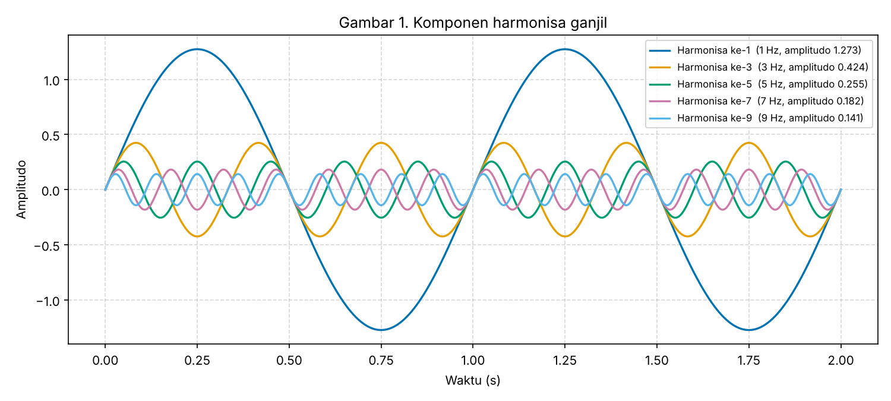
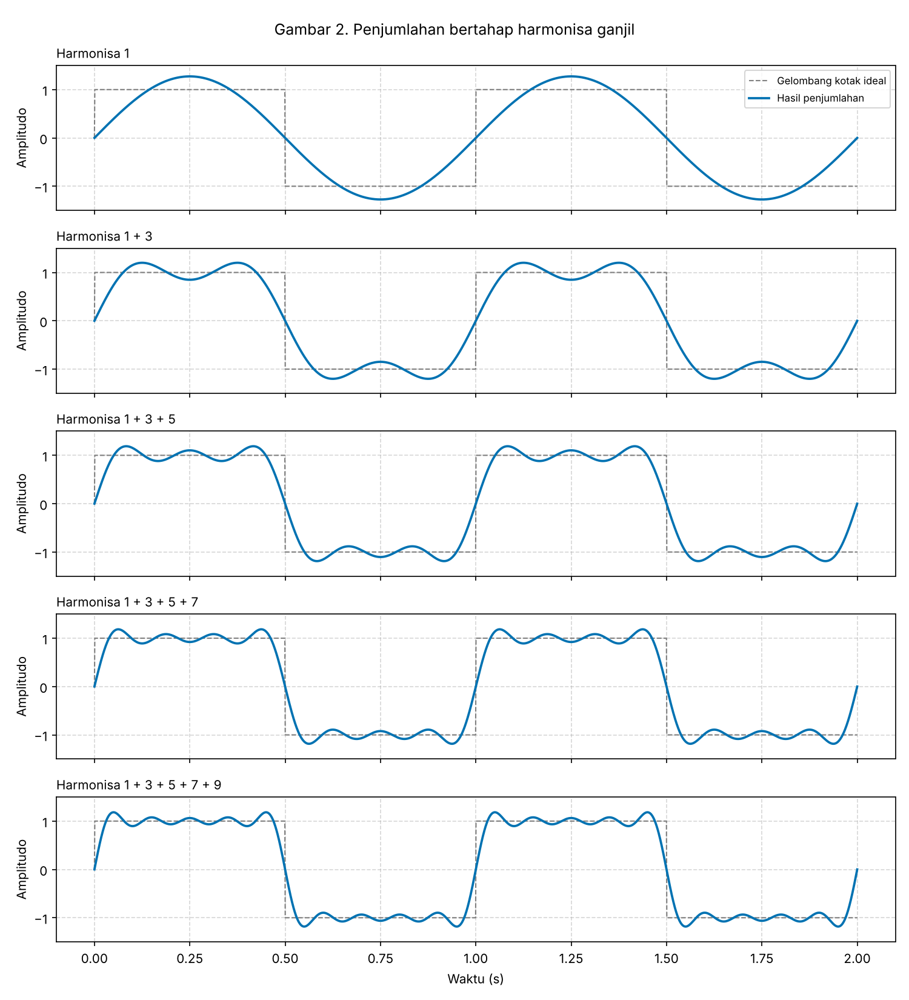
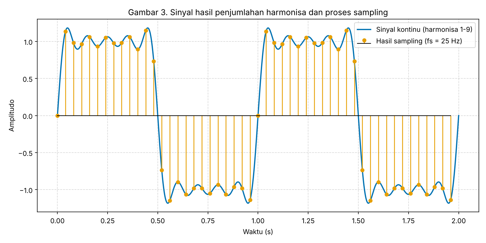
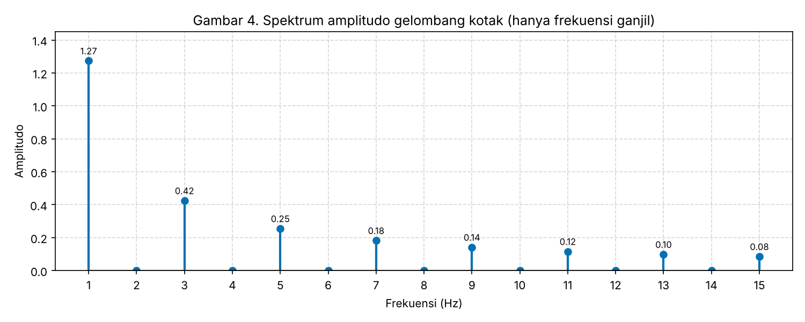

# KONSEP JARINGAN
## Tugas 3 — Visualisasi Penjumlahan Sinyal Harmonisa 1, 3, 5, ...

**DOSEN:**  
Dr. Ferry Astika Saputra, ST, M.Sc. (197708232001121002)

**PENYUSUN:**  
Prayogo Adhi Satrio (3125600043)

**PROGRAM STUDI SARJANA TERAPAN TEKNIK INFORMATIKA**  
**POLITEKNIK ELEKTRONIKA NEGERI SURABAYA**

---

## 1. Dasar Teori

Sinyal digital ideal berbentuk **gelombang kotak** (square wave): tegangan melompat dari nilai tinggi (bit 1) ke nilai rendah (bit 0). Menurut **deret Fourier**, gelombang kotak sebenarnya tersusun dari penjumlahan gelombang sinus dengan frekuensi kelipatan **ganjil** dari frekuensi dasar $f_0$:

$$
x(t) = \frac{4}{\pi} \sum_{n = 1, 3, 5, \dots}^{\infty} \frac{1}{n} \sin(2\pi n f_0 t)
$$

$$
x(t) = \frac{4}{\pi}\left[\sin(2\pi f_0 t) + \frac{1}{3}\sin(2\pi \cdot 3f_0 t) + \frac{1}{5}\sin(2\pi \cdot 5f_0 t) + \dots\right]
$$

Keterangan:

- $n = 1$ disebut **harmonisa dasar (fundamental)**; frekuensinya sama dengan $f_0$.
- $n = 3, 5, 7, \dots$ adalah **harmonisa ganjil**. Harmonisa genap (2, 4, 6, ...) bernilai nol untuk gelombang kotak simetris.
- Amplitudo harmonisa ke-$n$ adalah $\frac{4}{\pi n}$, sehingga semakin tinggi frekuensinya, semakin kecil kontribusinya.
- Faktor $\frac{4}{\pi}$ membuat hasil penjumlahan mendekati amplitudo ±1.

Kaitannya dengan jaringan komputer (Physical layer): media transmisi hanya meloloskan rentang frekuensi tertentu (**bandwidth**). Semakin sedikit harmonisa yang lolos, semakin "bulat" bentuk sinyal di penerima, sehingga bit lebih sulit dibedakan.

## 2. Parameter Simulasi

| Parameter | Nilai | Keterangan |
| :--- | :--- | :--- |
| Frekuensi dasar ($f_0$) | 1 Hz | Satu periode gelombang = 1 detik |
| Durasi pengamatan | 2 detik | Menampilkan 2 periode |
| Harmonisa yang dijumlahkan | 1, 3, 5, 7, 9 | Hanya harmonisa ganjil |
| Frekuensi tertinggi ($f_{max}$) | 9 Hz | Harmonisa ke-9 |
| Frekuensi sampling ($f_s$) | 25 Hz | 25 sampel per detik |
| Syarat Nyquist | $f_s > 2 f_{max} = 18$ Hz | **Terpenuhi** (25 Hz > 18 Hz) |

## 3. Kode Program (`harmonisa.py`)

```python
import numpy as np
import matplotlib.pyplot as plt

# 1. Parameter
f0 = 1                           # frekuensi dasar (Hz)
durasi = 2                       # lama pengamatan (detik) = 2 periode
t = np.linspace(0, durasi, 2000) # waktu "kontinu" (resolusi tinggi)
harmonisa = [1, 3, 5, 7, 9]      # hanya harmonisa GANJIL
fs = 25                          # frekuensi sampling (Hz)
t_s = np.arange(0, durasi, 1 / fs)

# Warna yang tetap mudah dibedakan (ramah buta warna)
WARNA = ["#0072B2", "#E69F00", "#009E73", "#CC79A7", "#56B4E9"]


def komponen(n, waktu):
    """Satu komponen deret Fourier gelombang kotak: (4/pi) * sin(2*pi*n*f0*t) / n"""
    return (4 / np.pi) * np.sin(2 * np.pi * n * f0 * waktu) / n


def jumlah_harmonisa(daftar_n, waktu):
    """Menjumlahkan komponen-komponen harmonisa pada daftar_n."""
    total = np.zeros_like(waktu)
    for n in daftar_n:
        total += komponen(n, waktu)
    return total


# Gelombang kotak ideal sebagai pembanding
kotak_ideal = np.sign(np.sin(2 * np.pi * f0 * t))

# Gambar 1 - Komponen harmonisa satu per satu
plt.figure(figsize=(10, 4.5))
for i, n in enumerate(harmonisa):
    plt.plot(t, komponen(n, t), color=WARNA[i], linewidth=1.6,
             label=f"Harmonisa ke-{n}  ({n * f0} Hz, amplitudo {4 / (np.pi * n):.3f})")
plt.title("Gambar 1. Komponen harmonisa ganjil")
plt.xlabel("Waktu (s)")
plt.ylabel("Amplitudo")
plt.grid(True, linestyle="--", alpha=0.5)
plt.legend(fontsize=8, loc="upper right")
plt.tight_layout()
plt.savefig("gambar1_komponen_harmonisa.png", dpi=150)

# Gambar 2 - Penjumlahan bertahap 1, 1+3, 1+3+5, ...
fig, axes = plt.subplots(len(harmonisa), 1, figsize=(10, 11), sharex=True)
for i, ax in enumerate(axes):
    dipakai = harmonisa[: i + 1]
    ax.plot(t, kotak_ideal, color="gray", linestyle="--", linewidth=1,
            label="Gelombang kotak ideal")
    ax.plot(t, jumlah_harmonisa(dipakai, t), color=WARNA[0], linewidth=1.8,
            label="Hasil penjumlahan")
    judul = " + ".join(str(n) for n in dipakai)
    ax.set_title(f"Harmonisa {judul}", fontsize=10, loc="left")
    ax.set_ylim(-1.5, 1.5)
    ax.set_ylabel("Amplitudo")
    ax.grid(True, linestyle="--", alpha=0.5)
axes[0].legend(fontsize=8, loc="upper right")
axes[-1].set_xlabel("Waktu (s)")
fig.suptitle("Gambar 2. Penjumlahan bertahap harmonisa ganjil", fontsize=12)
fig.tight_layout()
fig.savefig("gambar2_penjumlahan_bertahap.png", dpi=150)

# Gambar 3 - Sinyal hasil penjumlahan dan hasil sampling
s_kontinu = jumlah_harmonisa(harmonisa, t)
s_diskrit = jumlah_harmonisa(harmonisa, t_s)

plt.figure(figsize=(10, 5))
plt.plot(t, s_kontinu, color=WARNA[0], linewidth=1.8, label="Sinyal kontinu (harmonisa 1-9)")
titik, garis, dasar = plt.stem(t_s, s_diskrit, label=f"Hasil sampling (fs = {fs} Hz)")
plt.setp(garis, color=WARNA[1], linewidth=1.2)
plt.setp(titik, color=WARNA[1], markersize=5)
plt.setp(dasar, color="black", linewidth=1)
plt.title("Gambar 3. Sinyal hasil penjumlahan harmonisa dan proses sampling")
plt.xlabel("Waktu (s)")
plt.ylabel("Amplitudo")
plt.grid(True, linestyle="--", alpha=0.5)
plt.legend(loc="upper right")
plt.tight_layout()
plt.savefig("gambar3_sampling.png", dpi=150)

# Gambar 4 - Spektrum frekuensi (domain frekuensi)
n_spektrum = np.arange(1, 16)
amplitudo = np.where(n_spektrum % 2 == 1, 4 / (np.pi * n_spektrum), 0)

plt.figure(figsize=(10, 4))
titik, garis, dasar = plt.stem(n_spektrum * f0, amplitudo)
plt.setp(garis, color=WARNA[0], linewidth=2)
plt.setp(titik, color=WARNA[0], markersize=6)
plt.setp(dasar, color="black", linewidth=1)
for n, a in zip(n_spektrum, amplitudo):
    if a > 0:
        plt.text(n * f0, a + 0.04, f"{a:.2f}", ha="center", fontsize=8)
plt.title("Gambar 4. Spektrum amplitudo gelombang kotak (hanya frekuensi ganjil)")
plt.xlabel("Frekuensi (Hz)")
plt.ylabel("Amplitudo")
plt.xticks(n_spektrum * f0)
plt.ylim(0, 1.45)
plt.grid(True, linestyle="--", alpha=0.5)
plt.tight_layout()
plt.savefig("gambar4_spektrum.png", dpi=150)

# Ringkasan angka di terminal
print(f"Frekuensi sampling        : {fs} Hz")
print(f"Frekuensi tertinggi       : {max(harmonisa) * f0} Hz")
print(f"Syarat Nyquist (2 x fmax) : {2 * max(harmonisa) * f0} Hz -> "
      f"{'terpenuhi' if fs > 2 * max(harmonisa) * f0 else 'TIDAK terpenuhi'}")
print(f"Nilai puncak sinyal       : {s_kontinu.max():.3f}")

plt.show()
```

Output terminal:

```
Frekuensi sampling        : 25 Hz
Frekuensi tertinggi       : 9 Hz
Syarat Nyquist (2 x fmax) : 18 Hz -> terpenuhi
Nilai puncak sinyal       : 1.182
```

## 4. Hasil Visualisasi

### Gambar 1 — Komponen harmonisa ganjil



Setiap harmonisa adalah gelombang sinus murni. Harmonisa ke-1 (1 Hz) memiliki amplitudo terbesar, yaitu 1,273. Harmonisa berikutnya bergetar lebih cepat (3, 5, 7, 9 Hz) dengan amplitudo yang mengecil sebanding $\frac{1}{n}$: 0,424; 0,255; 0,182; dan 0,141.

### Gambar 2 — Penjumlahan bertahap



| Harmonisa yang dijumlahkan | Bentuk sinyal |
| :--- | :--- |
| 1 | Masih berupa gelombang sinus biasa; jauh dari bentuk kotak. |
| 1 + 3 | Puncak mulai mendatar dan sisi naik/turun lebih curam; muncul dua tonjolan di setiap puncak. |
| 1 + 3 + 5 | Bagian atas makin rata, transisi makin tajam. |
| 1 + 3 + 5 + 7 | Bentuk sudah jelas menyerupai kotak, riak (ripple) makin kecil dan rapat. |
| 1 + 3 + 5 + 7 + 9 | Paling mendekati gelombang kotak ideal; riak tersisa terutama di dekat titik transisi. |

Semakin banyak harmonisa ganjil yang dijumlahkan, semakin tajam tepi sinyal dan semakin rata bagian puncaknya.

### Gambar 3 — Sinyal hasil penjumlahan dan sampling



Garis biru adalah sinyal kontinu hasil penjumlahan harmonisa 1–9. Batang oranye adalah hasil **sampling**, yaitu nilai sinyal yang diambil setiap $\frac{1}{25} = 0{,}04$ detik (50 sampel dalam 2 detik). Karena $f_s = 25$ Hz lebih besar dari $2 \times 9 = 18$ Hz, syarat **Nyquist** terpenuhi sehingga sinyal tersebut secara teori dapat direkonstruksi kembali tanpa aliasing.

### Gambar 4 — Spektrum frekuensi



Dalam domain frekuensi, gelombang kotak hanya memiliki komponen pada frekuensi ganjil (1, 3, 5, ... Hz); frekuensi genap bernilai nol. Tinggi batang menurun mengikuti $\frac{4}{\pi n}$.

## 5. Analisis

1. **Hanya harmonisa ganjil yang dibutuhkan.** Gelombang kotak simetris memiliki simetri setengah gelombang, sehingga semua komponen genap saling meniadakan. Itu sebabnya daftar harmonisa pada program hanya berisi 1, 3, 5, 7, 9.
2. **Gelombang kotak sempurna butuh harmonisa tak hingga.** Dengan lima harmonisa, sinyal sudah menyerupai kotak, tetapi tepinya belum tegak sempurna. Tepi yang benar-benar tegak membutuhkan frekuensi sangat tinggi yang jumlahnya tak terbatas.
3. **Fenomena Gibbs.** Di dekat titik transisi selalu muncul lonjakan (overshoot). Pada simulasi ini puncaknya mencapai **1,182** atau sekitar 18% di atas nilai ideal 1. Menambah harmonisa membuat riak lebih rapat dan sempit, tetapi tinggi lonjakannya tidak hilang; secara teori mendekati ±9% dari lompatan total (lompatan dari −1 ke +1 = 2).
4. **Hubungan dengan bandwidth jaringan.** Media transmisi bekerja seperti filter low-pass: hanya harmonisa di bawah batas bandwidth yang lolos. Bila sebuah kabel hanya meloloskan sampai 3 Hz, penerima hanya mendapat sinyal seperti panel "1 + 3" pada Gambar 2. Untuk data berkecepatan tinggi, frekuensi dasar sinyal juga tinggi, sehingga dibutuhkan bandwidth yang lebih besar agar harmonisa pentingnya tetap terbawa.
5. **Sampling dan Nyquist.** Saat sinyal dikonversi ke digital, frekuensi sampling minimal harus dua kali frekuensi tertinggi. Bila $f_s$ diturunkan di bawah 18 Hz, misalnya 10 Hz, harmonisa ke-7 dan ke-9 akan "menyamar" menjadi frekuensi lain (aliasing), sehingga bentuk sinyal hasil rekonstruksi menjadi salah.

## 6. Kesimpulan

- Gelombang kotak (sinyal digital) dapat dibentuk dari penjumlahan gelombang sinus dengan frekuensi kelipatan ganjil, masing-masing beramplitudo $\frac{4}{\pi n}$.
- Semakin banyak harmonisa yang dijumlahkan, semakin mirip sinyal dengan gelombang kotak ideal, tetapi overshoot di tepi (fenomena Gibbs) tetap ada.
- Bandwidth media transmisi menentukan berapa banyak harmonisa yang sampai ke penerima, sehingga menentukan kualitas bentuk sinyal digital.
- Frekuensi sampling 25 Hz sudah memenuhi syarat Nyquist untuk sinyal dengan harmonisa tertinggi 9 Hz.

## Referensi

1. Forouzan, B. A. *Data Communications and Networking* (edisi ke-5). McGraw-Hill. Bab 3: Data and Signals (composite signals dan bandwidth).
2. Oppenheim, A. V., & Willsky, A. S. *Signals and Systems* (edisi ke-2). Prentice Hall. Bab 3: Fourier Series Representation of Periodic Signals.
3. Dokumentasi NumPy dan Matplotlib: https://numpy.org/doc dan https://matplotlib.org/stable
